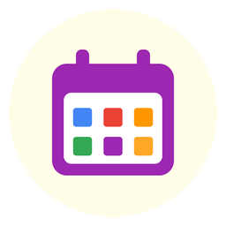

<p align="center">
  
</p>

<h1 align="center">EpiValastor pour Android</h1>

<p align="center">
  Ton emploi du temps (Zeus, Hyperplanning… via un lien <b>ICS</b>) toujours sous les yeux :<br>
  planning, temps restant, examens, changements de dernière minute.<br>
  Version Mac / iPhone / iPad : <a href="https://github.com/Valastored/epivalastor-apple">epivalastor-apple</a>
</p>

---

## ⬇️ Télécharger

**[📥 EpiValastor.apk](https://github.com/Valastored/epivalastor-android/raw/main/download/EpiValastor.apk)** — Android 8.0 ou plus récent · version **2.0**

Ouvre ce lien **depuis ton téléphone** : le téléchargement démarre directement.

---

## 📲 Installer

1. Télécharge **EpiValastor.apk** (lien ci-dessus) et ouvre le fichier (notification de téléchargement, ou app **Fichiers › Téléchargements**).
2. Android demande d'autoriser l'installation : **Paramètres › Autoriser cette source** (pour ton navigateur ou ton gestionnaire de fichiers), puis reviens en arrière.
3. Touche **Installer**.
   Si **Google Play Protect** affiche un avertissement (« application inconnue »), choisis **Plus de détails › Installer quand même** :
   l'app n'est simplement pas publiée sur le Play Store.
4. Ouvre **EpiValastor** et **autorise les notifications**.
5. ⚙️ **Réglages › Agendas** : colle ton lien ICS, donne un nom et une couleur, puis **Ajouter le lien**.

**Mise à jour** : télécharge le nouvel APK et installe-le par-dessus — tes agendas et réglages sont conservés.

### 🔗 Où trouver ton lien ICS ?
Dans ton outil d'emploi du temps (ex. **Zeus** pour l'EPITA / IONIS), cherche **Exporter / iCal / S'abonner** sur la vue de ton groupe
et copie le lien (`https://…ics…`). Astuce Zeus : ajoute `?startDate=2026-08-15` à la fin pour récupérer aussi les cours passés.
⚠️ Ce lien est personnel : ne le partage pas publiquement.

### ⚙️ Réglages conseillés
- **Live Update** (Android 16+) : le temps restant reste affiché dans la barre d'état pendant le cours.
  Si Android le bloque : *Réglages EpiValastor › Notifications › Réglages des notifications Android*.
- **Batterie** : si les rappels arrivent en retard, mets EpiValastor en **« Non restreinte »** dans les paramètres de batterie de l'app.
- **Widget** : appui long sur l'écran d'accueil › **Widgets** › EpiValastor (redimensionnable de 1×1 à grand format).

---

## ✨ Fonctionnalités

- **Planning semaine / jour** : un bloc par jour avec horaires de début–fin, pauses, ligne rouge de progression ; centré sur aujourd'hui à l'ouverture.
- **Examens** (partiel, QCM, contrôle, soutenance…) en rouge + rappel la veille à 19 h ; **fériés / vacances** en bleu-vert, hors statistiques.
- **Notifications** : cours en cours avec compte à rebours (mis à jour chaque minute, **Live Update** sur Android 16), rappel avant chaque cours
  (5, 10, 15, 30 min ou 1 h), **changements d'emploi du temps** (ajouts, annulations, déplacements).
- **Synchro automatique** chaque jour vers 6 h, à l'ouverture et en tirant vers le bas ; l'historique des cours passés est conservé.
- **Widget** « prochain cours » redimensionnable, **pastille prochain cours** dans l'app.
- **Recherche** par matière, prof ou salle · **mini-calendrier** · **statistiques** (heures par matière, avancement…).
- **Partage / enregistrement en image** d'un jour ou d'une semaine.
- **Raccourcis** (appui long sur l'icône) : Aujourd'hui, Rechercher, Synchroniser, Statistiques.
- Thème **Système / Clair / Sombre**, matières masquables, plusieurs agendas avec couleurs, réglages en plusieurs pages.

---

## 🛠️ Compiler depuis le code

Prérequis : **Android Studio** récent (SDK 36).

```bash
git clone https://github.com/Valastored/epivalastor-android.git
```

Ouvre le dossier dans Android Studio, laisse Gradle se synchroniser, puis ▶ (Run).
Pour un APK : **Build › Generate Signed App Bundle / APK › APK** (avec ta propre clé de signature).

---

<p align="center">Développé par <b>Valastor</b></p>
